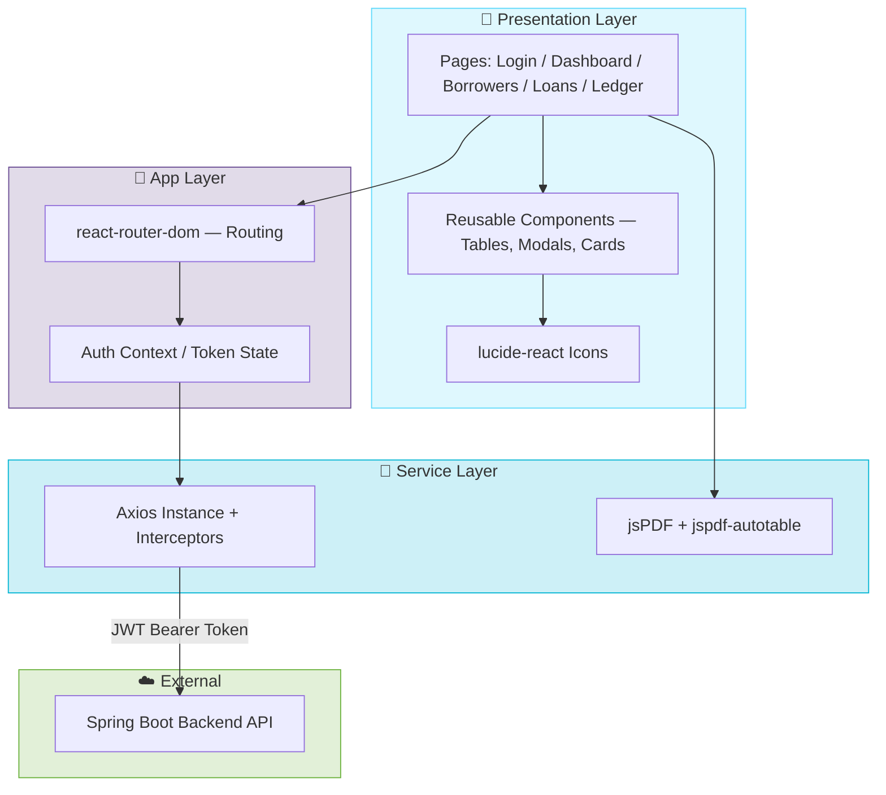
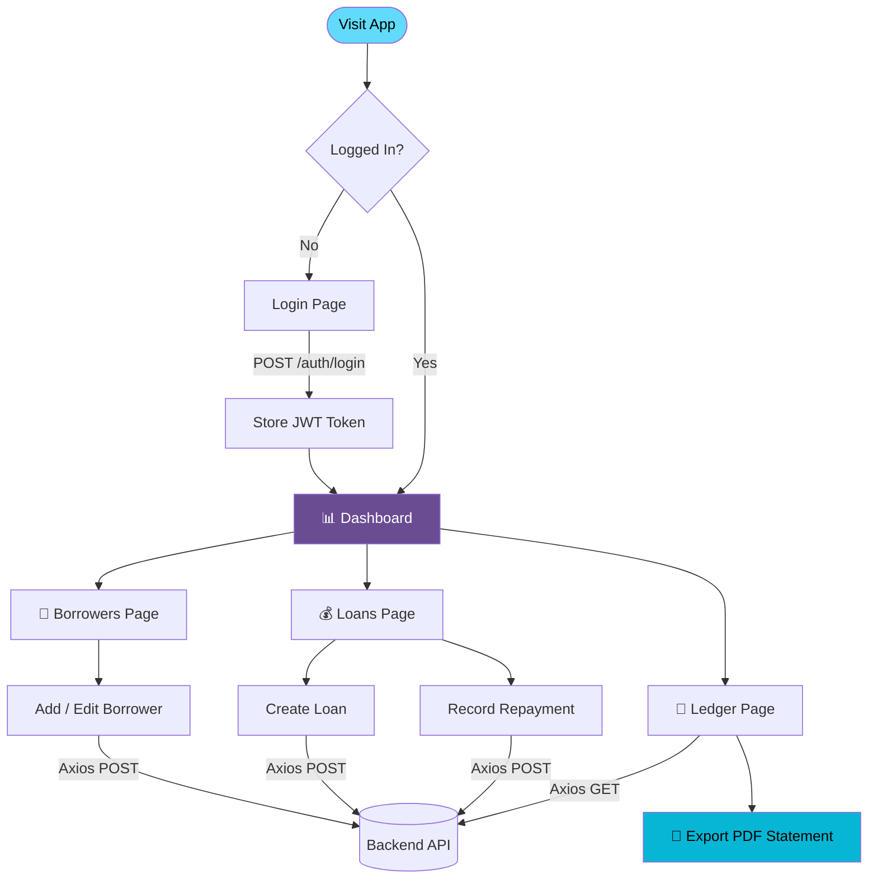
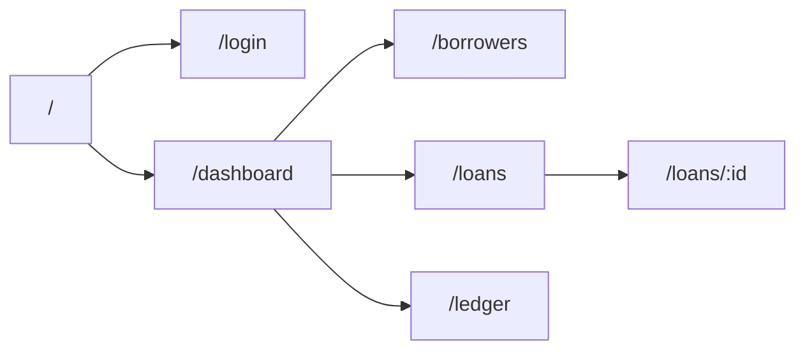
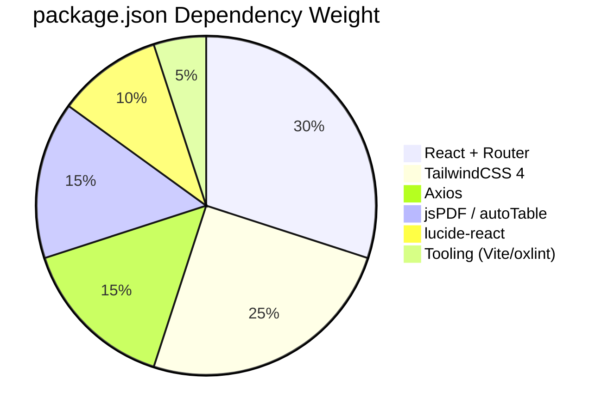
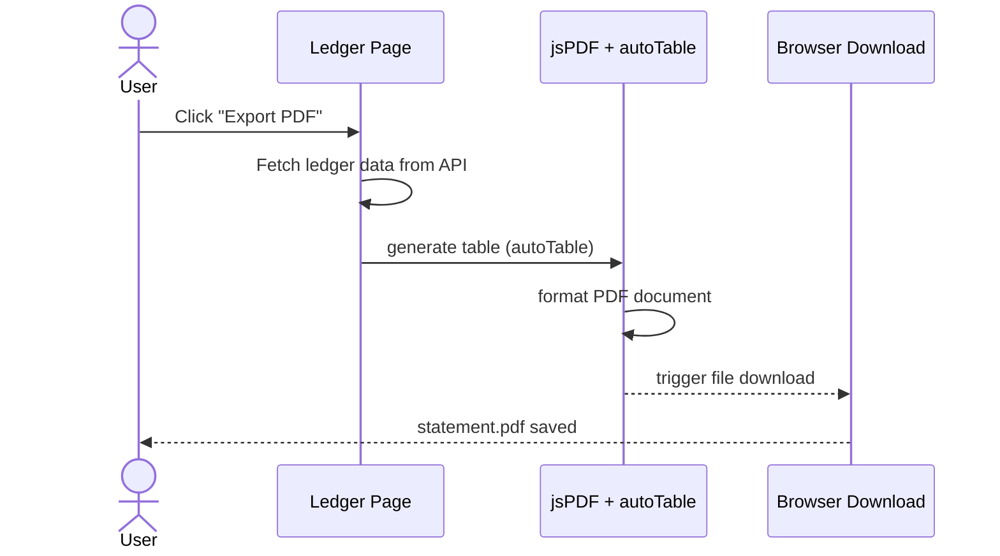
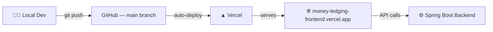

<div align="center">


<p>
  <a href="https://money-ledging-frontend.vercel.app/"></a>
</p>

<p>
  
  
  
  
  
</p>

<p>
  
  
  
  
  
</p>


</div>

---

## 📖 Overview

The **Money Ledging Frontend** is a fast, responsive dashboard built with **React 19** and **Vite 8**, styled with **TailwindCSS 4**, and connected to the [Money_Ledging_Backend](https://github.com/ashrithBalaji456/Money_Ledging_Backend) REST API via **Axios**. Lenders can manage borrowers, issue loans, log repayments, and export ledger statements as PDF — all from a clean, single-page interface.

🌐 **Live App:** [money-ledging-frontend.vercel.app](https://money-ledging-frontend.vercel.app/)
🔗 **Backend API:** [Money_Ledging_Backend](https://github.com/ashrithBalaji456/Money_Ledging_Backend)

---

## 🧭 App Architecture & Data Flow



---

## 🔄 User Journey Workflow



---

## 🗺️ Routing Map



> Exact route paths are defined via `react-router-dom` in the app's router config — adjust to match `src/` if route names differ.

---

## 📁 Project Structure

```
Money_Ledging_Frontend/
├── public/
├── src/
│   ├── components/       # Reusable UI components (tables, modals, cards)
│   ├── pages/             # Route-level pages (Login, Dashboard, Loans...)
│   ├── services/          # Axios API client & endpoint wrappers
│   ├── context/           # Auth / global state context
│   ├── utils/             # PDF export helpers, formatters
│   ├── App.jsx
│   └── main.jsx
├── index.html
├── vite.config.js
├── tailwind.config.js
├── postcss.config.js
└── package.json
```

---

## ⚙️ Tech Stack

| Category | Technology |
|---|---|
| UI Library | React 19 |
| Build Tool | Vite 8 |
| Styling | TailwindCSS 4 (`@tailwindcss/postcss`) |
| Routing | react-router-dom 7 |
| HTTP Client | Axios |
| Icons | lucide-react |
| PDF Export | jsPDF + jspdf-autotable |
| Linting | oxlint |
| Hosting | Vercel |

---

## 📊 Dependency Breakdown



---

## 🚀 Getting Started

### Prerequisites
- Node.js 18+
- npm 9+
- Running instance of [Money_Ledging_Backend](https://github.com/ashrithBalaji456/Money_Ledging_Backend)

### Installation

```bash
git clone https://github.com/ashrithBalaji456/Money_Ledging_Frontend.git
cd Money_Ledging_Frontend
npm install
```

The frontend API client is configured to call `https://money-ledging-backend.onrender.com`.

### Run Dev Server

```bash
npm run dev
```

App runs at `http://localhost:5173` with hot-module reload.

### Build for Production

```bash
npm run build
npm run preview
```

### Lint

```bash
npm run lint
```

---

## 🧾 PDF Ledger Export



---

## 🌍 Deployment



---

## 🤝 Contributing

```bash
git checkout -b feature/your-feature
git commit -m "feat: describe your change"
git push origin feature/your-feature
```
Then open a Pull Request against `main`.

## 📄 License

Add a `LICENSE` file (MIT recommended) to formalize usage terms.

---

<div align="center">

[](https://github.com/ashrithBalaji456/Money_Ledging_Backend)
[](https://money-ledging-frontend.vercel.app/)


</div>
